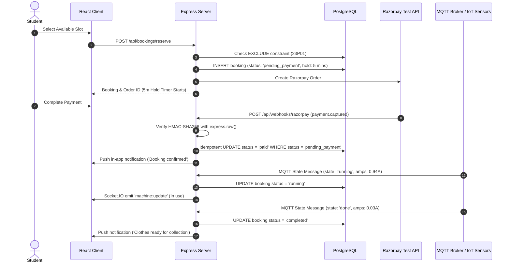

LaundryMart

A full-stack web application for a college laundry service serving 

The application is built for desktop and mobile browsers, features real-time Socket.IO synchronization, an MQTT IoT hardware telemetry simulator, 

---

## 1. System Architecture and Flows

### Architecture Overview

```mermaid
flowchart TD
    subgraph Client ["Client Layer (React / Vite)"]
        UI["Student & Staff Web App (React + Tailwind)"]
        

    subgraph Backend ["Backend Layer (Node.js / Express)"]
        API["Express REST API (Auth, Bookings, Staff, Chat)"]
        SocketServer["Socket.IO Server"]
        Webhook["Raw Webhook Handler (HMAC-SHA256)"]
        Watchdog["30s Telemetry Watchdog & 1m Hold Cleaner"]
        Ingestion["MQTT Ingestion Service (Subscriber)"]
        

    subgraph IoT ["IoT Layer (Simulated or Real Hardware)"]
        Mosquitto["Mosquitto MQTT Broker (:1883)"]
        Simulator["IoT Simulator / ESP32 Hardware (14 Nodes)"]
    end

    subgraph Storage ["Data Layer"]
        PG[("PostgreSQL 16 + pgvector + btree_gist")]
    end

    Simulator -->|Publish state & heartbeat| Mosquitto
    Mosquitto -->|Subscribe| Ingestion
    Ingestion -->|Update state & apply booking rules| PG
    Ingestion -->|Emit machine:update| SocketServer
    SocketServer -->|Live updates| SocketClient
    UI -->|HTTP requests| API
    API --> PG
    Webhook -->|Payment capture / refund events| API
    RzpCheckout -->|Trigger payment| Webhook
    RAG -->|Vector search & tool queries| PG
```

### Core Booking Lifecycle Sequence



---

## 2. Tech Stack

- **Frontend**: React (Vite), React Router
- **Backend**: Node.js with Express, Socket.IO, `mqtt` client, `bcryptjs`, `jsonwebtoken`, `zod` input validation, `helmet`, `cors`, and `express-rate-limit`.
- **Database**: PostgreSQL with `btree_gist` 
- **Messaging**: MQTT (Mosquitto broker), with an embedded Aedes broker option for offline local development.
- **Payments**: Razorpay test mode with server order creation, raw-body HMAC SHA256 webhook signatures, and automated refunds.
- **AI Assistant**: Anthropic SDK (`claude-haiku-5-5`) with tool calling (`get_my_bookings`, `get_transaction_status`, `get_machine_status`) and RAG over public markdown documentation.
- **Testing**: Vitest with unit and integration suites covering all concurrency, webhook idempotency, data isolation, and watchdog rules.

---

## 3. Project Structure

```
├── docker-compose.yml          # PostgreSQL & Mosquitto broker
├── mosquitto/config/           # Mosquitto broker configuration
├── client/                     # React Vite application
│   ├── src/
│   │   ├── context/            # AuthContext, SocketContext, NotificationContext
│   │   ├── components/         # Navbar, StatusBadge, NotificationBell, RazorpayModal
│   │   └── pages/              # StudentDashboard, LaundryDetail, MachineSlots, Transactions, ChatAssistant, StaffDashboard
├── server/                     # Express backend API & services
│   ├── src/
│   │   ├── migrations/         # 001_initial_schema.sql, 002_add_vector_and_constraints.sql
│   │   ├── seed/               # seed.js (1 staff, 3 students, 2 laundries, 14 machines)
│   │   ├── services/           # bookingService, ingestion, paymentService, chatService, ragService, notificationService
│   │   ├── routes/             # auth, laundries, machines, bookings, payments, webhooks, notifications, chat, staff
│   │   └── socket/             # Socket.IO event handler
│   ├── scripts/                # run-migrations.js, index-docs.js, e2e-demo.js
│   └── test/                   # Vitest automated test suite (bookings, payments, ingestion, chat)
├── iot-simulator/              # 14-node virtual hardware simulator
│   ├── simulator.js            # Cycle model (idle -> running -> done), heartbeats, amps
│   └── README.md               # Hardware specifications and ESP32 firmware guide
└── docs/                       # RAG Knowledge base with YAML frontmatter
    ├── policies/               # booking-and-cancellation.md, refunds.md, privacy.md
    ├── machines/               # how-machines-work.md, machine-status-meanings.md
    ├── offline-behavior/       # poor-network.md
    ├── faq/                    # common-questions.md
    ├── fabric-care/            # basics.md
    ├── staff-only/             # refund-operations.md, machine-maintenance.md
    └── README.md               # Documentation guidelines and reindexing instructions
```

---

## 4. Setup and Installation

### Prerequisites
- Node.js v18+ and npm v9+
- Docker and Docker Compose (recommended for PostgreSQL and Mosquitto)

### Step 1: Clone and Configure Environment
Copy `.env.example` in `server/` to `server/.env`:
```bash
cp server/.env.example server/.env
```

### Step 2: Start Infrastructure (PostgreSQL & Mosquitto)
Start the containers using Docker Compose:
```bash
docker compose up -d
```
*Note: If Docker is not available on your workstation, the backend includes an optional embedded MQTT broker (`USE_EMBEDDED_BROKER=true`) and test database engine.*

### Step 3: Run Database Migrations and Seed Data
From the `server/` folder:
```bash
cd server
npm run migrate
npm run seed
```

This seeds:
- 1 Staff account (`staff@college.edu` / `Password123!`)
- 3 Student accounts (`student1@college.edu`, `student2@college.edu`, `student3@college.edu` / `Password123!`)
- 2 Laundries: Laundry A (North Residence) and Laundry B (South Commons)
- 14 Machines with prices, slot durations, and idle states.


### Step 5: Start the IoT Simulator
In a separate terminal:
```bash
cd iot-simulator
npm start
```
The simulator connects to the MQTT broker, initializes 14 virtual devices

### Step 6: Start Backend Server
In another terminal:
```bash
cd server
npm run dev
```
The server runs on `http://localhost:5000`.

### Step 7: Start React Client
In another terminal:
```bash
cd client
npm run dev
```
The web application opens at `http://localhost:5173`.

---

## 5. Running Automated Tests

Run the test suite covering all 10 core acceptance criteria:
```bash
cd server
npm test
```

### Tested Criteria:
1. Two students cannot book overlapping slots on the same machine (PostgreSQL EXCLUDE constraint 23P01).
2. An unpaid hold expires after 5 minutes and releases the slot.
3. A duplicate Razorpay webhook does not change a booking twice.
4. A webhook with an invalid HMAC signature is rejected.
5. A paid booking whose machine never starts is marked `failed` after the 5-minute grace period and refunded in full.
6. A student cancellation refunds 100% in full and immediately releases the slot.
7. A payment captured without a valid booking is refunded in full automatically.
8. A student cannot read another student's booking or transaction via chat tools (server-side authorization).
9. The chat model never receives personal fields (strict tool serializer redacts names, emails, and phone numbers).


---

## 6. Running the End-to-End Demo Script

An automated end-to-end demo script verifies the full lifecycle from reservation to wash completion:
```bash
cd server
npm run demo
```

Execution stages:
1. Student reserves a washer slot (creates `pending_payment` with 5-minute hold).
2. Razorpay payment capture confirmed (transitions booking to `paid`).
3. Simulated IoT sensor draws current (>0.50A) and publishes state `running` (transitions booking to `running`).
4. Wash finishes, current drops to 0.03A, sensor publishes state `done` (transitions booking to `completed` and issues in-app notification).

---

## 7. Replacing the IoT Simulator with Real ESP32 Hardware

The backend ingestion layer (`server/src/services/ingestion.js`) was engineered to be completely hardware-agnostic. To replace the simulator with physical ESP32 boards equipped with SCT-013 AC current clamp sensors:

1. Flash standard ESP32 firmware with Wi-Fi and MQTT client libraries (`PubSubClient` or ESP-IDF MQTT).
2. Point the ESP32 to the campus Mosquitto MQTT broker on port 1883.
3. Configure each device to publish root-mean-square current draw:
   - **Heartbeat Topic**: `laundry/{laundryId}/machine/{machineId}/heartbeat`
     Payload: `{"ts": 1730700000, "fw": "esp32-v1.0"}` (every 30 seconds)
   - **State Topic**: `laundry/{laundryId}/machine/{machineId}/state`
     Payload: `{"state": "running", "amps": 0.94, "ts": 1730700000}`
4. Set hardware state thresholds:
   - Current < 0.10A: `idle`
   - Current >= 0.50A for >15s: `running`
   - Current drops back < 0.10A for >60s: `done`
5. **No code, database, or API changes are required on the server or client.**

--


---

## 8. Demo Credentials

| Role | Email | Password | Permissions |
|---|---|---|---|
| Staff | `staff@college.edu` | `Password123!` | Full Staff Dashboard, machine management, audit logs, price/slot configs |
| Student 1 | `student1@college.edu` | `Password123!` | Machine booking, cancellations, chat assistant, in-app alerts |
| Student 2 | `student2@college.edu` | `Password123!` | Machine booking, cancellations, chat assistant, in-app alerts |
| Student 3 | `student3@college.edu` | `Password123!` | Machine booking, cancellations, chat assistant, in-app alerts |
